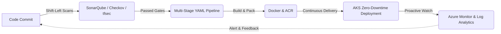

<p align="center">
  
</p>

<p align="center">
  <a href="https://linkedin.com/in/vikash-keshri">
    
  </a>
</p>

<p align="center">
  <a href="https://linkedin.com/in/vikash-keshri" target="_blank">
    
  </a>
  <a href="mailto:keshrivikash887@gmail.com">
    
  </a>
  <a href="tel:+917004696959">
    
  </a>
  <a href="#-contact--quick-interview">
    
  </a>
  
</p>

---

### 👨‍💻 Executive Summary & Recruiter Snapshot

> **Results-driven DevOps & Cloud Platform Engineer** with **2+ years of enterprise experience** architecting, provisioning, automating, and securing production-grade cloud environments on **Microsoft Azure**, with foundational exposure to **AWS** and **GCP**.
>
> Proven record of delivering **99.9% uptime**, orchestrating automated **zero-downtime rolling deployments on AKS**, building **modular reusable Terraform templates** compliant with Microsoft Cloud Adoption Framework (CAF), and enforcing **Zero-Trust Hub-Spoke security architectures** with shift-left DevSecOps gates.

```yaml
candidate_profile:
  name: "Vikash Keshri"
  role: "DevOps & Cloud Engineer"
  experience: "2+ Years (Startek - Production Environment)"
  core_cloud: "Microsoft Azure (Hub-Spoke, AKS, App Gateway, Key Vault, Entra ID)"
  iac_mastery: "Terraform (Modules, Remote State, Workspaces, CAF), Bicep"
  cicd_automation: "Azure DevOps (YAML Multi-Stage Pipelines), GitHub Actions"
  container_orchestration: "Kubernetes (AKS), Docker, Ingress Controllers"
  security_mindset: "DevSecOps (Checkov, tfsec, SonarQube, Snyk, GitLeaks, PIM, RBAC)"
  availability_sla: "99.9% Production Reliability Achieved"
  preferred_location: "Bengaluru, India / Hybrid / Remote"
  notice_period: "Immediate / Short Notice"
```

---

### 💼 Professional Experience Showcase

#### 🏢 **Startek** — **DevOps Engineer** *(July 2024 – August 2026 | 2+ Years)*
*Enterprise cloud infrastructure provisioning, CI/CD pipeline automation, and DevSecOps governance.*

* 🏗️ **Infrastructure as Code (IaC):** Engineered modular, enterprise-ready **Terraform** configurations for Dev, QA, and Production environments aligned with the **Microsoft Cloud Adoption Framework (CAF)**, cutting environment provisioning time by over 60%.
* 🔄 **Enterprise CI/CD Pipelines:** Built multi-stage **Azure DevOps YAML pipelines** incorporating automated pull request validations, unit tests, manual approvals & deployment gates, ensuring zero-downtime production releases.
* 🐳 **Container Orchestration (AKS):** Containerized microservices workloads using **Docker** and deployed them to **Azure Kubernetes Service (AKS)** integrated with **Azure Container Registry (ACR)** and Ingress controllers, enabling rolling updates with 0% downtime.
* 🌐 **Zero-Trust Network Architecture:** Architected and deployed secure **Hub-Spoke VNet topologies**, centralized **Azure Application Gateway** with WAF rules, and configured Network Security Groups (NSGs) with **Private Endpoints** to isolate Azure SQL, Storage Accounts, and Key Vault.
* 🛡️ **DevSecOps Shift-Left Security:** Integrated static code and security vulnerability analysis into CI/CD pipelines using **Checkov**, **tfsec**, **SonarQube**, and **GitLeaks**, mitigating critical and high-severity vulnerabilities before reaching production.
* 🔐 **Cloud Identity & Governance:** Enforced least-privilege access using **Microsoft Entra ID**, **Azure RBAC**, and Privileged Identity Management (**PIM**) across multi-tenant enterprise Azure subscriptions.
* 📊 **Proactive Observability:** Implemented automated health dashboards and alerting rules utilizing **Azure Monitor**, **Log Analytics Workspaces**, and **Network Watcher**, accelerating Mean Time to Detect (MTTD) and Resolve (MTTR).
* ⚙️ **Hybrid Web Infrastructure:** Administered high-volume IIS environments (SSL/TLS cert renewals, app pool tuning, access log analysis) and automated recurring operational tasks with **PowerShell** scripts.

---

### 🛠️ Technical Skills & Tooling Matrix

<table>
  <tr>
    <td align="center" width="25%"><b>Category</b></td>
    <td align="center" width="75%"><b>Enterprise Technologies & Competencies</b></td>
  </tr>
  <tr>
    <td align="center"><b>☁️ Cloud Platforms</b></td>
    <td>
      
      
      
      <br/>
      <sub><b>Azure Services:</b> VNets, Hub-Spoke, Application Gateway, Azure Kubernetes Service (AKS), App Services, VMSS, Storage Accounts, Key Vault, Entra ID (Azure AD), PIM, RBAC, Azure Policy</sub>
    </td>
  </tr>
  <tr>
    <td align="center"><b>🏗️ Infrastructure as Code</b></td>
    <td>
      
      
      
      <br/>
      <sub>Modular Terraform architecture, Remote Backend State Locking (Azure Blob), Workspaces, Cloud Adoption Framework (CAF) Landing Zones</sub>
    </td>
  </tr>
  <tr>
    <td align="center"><b>🔄 CI/CD & Automation</b></td>
    <td>
      
      
      
      <br/>
      <sub>Multi-stage YAML pipelines, Self-hosted/Microsoft-hosted agents, Approvals & Quality Gates, Artifacts, Branching strategies</sub>
    </td>
  </tr>
  <tr>
    <td align="center"><b>🐳 Containers & Orchestration</b></td>
    <td>
      
      
      
      
      <br/>
      <sub>Microservices containerization, multi-stage Docker builds, AKS cluster maintenance, Ingress controllers (NGINX/AGIC), rolling updates</sub>
    </td>
  </tr>
  <tr>
    <td align="center"><b>🛡️ DevSecOps & Governance</b></td>
    <td>
      
      
      
      
      
      <br/>
      <sub>Shift-Left Security, GitLeaks secret scanning, CIS Benchmarks, Azure Policies, Managed Identities, Zero-Credential deployments</sub>
    </td>
  </tr>
  <tr>
    <td align="center"><b>📊 Observability & Monitoring</b></td>
    <td>
      
      
      
      
      
      <br/>
      <sub>KQL (Kusto Query Language), Log alerting rules, Application Insights, Network Watcher diagnostics, SLA/SLO dashboards</sub>
    </td>
  </tr>
  <tr>
    <td align="center"><b>💻 Systems & Scripting</b></td>
    <td>
      
      
      
      
      
      <br/>
      <sub>Shell automation, Cron jobs, system administration, IIS Web Server management, SSL/TLS certificate handling</sub>
    </td>
  </tr>
</table>

---

### 🚀 Highlighted Enterprise Projects

<table>
  <tr>
    <td width="50%" valign="top">
      <h3>🏛️ 1. Enterprise Cloud Infrastructure for LMS</h3>
      <p><b>Tech Stack:</b> <code>Microsoft Azure</code> <code>Terraform</code> <code>AKS</code> <code>Azure DevOps</code> <code>Azure Key Vault</code></p>
      <ul>
        <li><b>High Availability Architecture:</b> Architected and automated the deployment of a resilient, scalable Learning Management System (LMS) on Microsoft Azure.</li>
        <li><b>Modular Terraform:</b> Developed reusable Terraform modules backed by Azure Blob Storage remote state with locking, managing multi-tier environments seamlessly.</li>
        <li><b>End-to-End CI/CD:</b> Built comprehensive multi-stage Azure DevOps YAML pipelines automating linting, security scans, unit tests, and deployments to AKS & Azure App Services.</li>
        <li><b>Zero-Credential Security:</b> Integrated Azure Key Vault with Azure Managed Identities, completely eliminating plain-text secrets and API credentials from Git repositories.</li>
      </ul>
    </td>
    <td width="50%" valign="top">
      <h3>🌐 2. Azure Network Operations & Infrastructure Governance</h3>
      <p><b>Tech Stack:</b> <code>Hub-Spoke VNet</code> <code>Application Gateway</code> <code>NSGs</code> <code>PowerShell</code> <code>Network Watcher</code></p>
      <ul>
        <li><b>Zero-Trust Network Topology:</b> Designed a centralized Hub-Spoke VNet architecture with Azure Application Gateway routing and inspecting ingress and egress traffic.</li>
        <li><b>Secure Data Layer Isolation:</b> Implemented Private Endpoints and custom NSG rules for Azure SQL and Storage, preventing exposure to the public internet.</li>
        <li><b>Automated Diagnostics:</b> Created custom PowerShell automation scripts integrated with Azure Network Watcher to run continuous compliance verification and audit NSG flow logs.</li>
        <li><b>Security Hardening:</b> Audited and enforced CIS benchmark rules across all enterprise VNets and subnets.</li>
      </ul>
    </td>
  </tr>
</table>

---

### 💡 DevOps Philosophy & Engineering Practices



* **⚡ Everything as Code:** From infrastructure (Terraform/Bicep) and multi-stage pipelines (YAML) to policies (Azure Policy as Code).
* **🔒 Security Built-In, Not Bolted On:** Vulnerability scanning with Checkov, tfsec, and SonarQube in pull requests before any terraform apply or container build.
* **🎯 High Availability by Design:** Redundant zone architectures, automated healing, rolling updates, and comprehensive health probes.
* **📈 Proactive Observability:** Monitoring telemetry, Log Analytics alerts, and metric thresholds to resolve issues before users notice.

---

### 📊 GitHub Productivity & Live Stats

<p align="center">
  
  &nbsp;
  
</p>

<p align="center">
  
</p>

---

### 🎓 Education & Continuous Upskilling

* 🎓 **Bachelor of Science (Honours) in Physics** — Vinoba Bhave University, Hazaribagh (2019)
* 🚀 **Intensive Cloud & DevOps Specialization (2020 – 2024):** Deep hands-on specialization in Linux Systems, Distributed Cloud Networking, Microsoft Azure Architecture, Kubernetes (AKS), and Infrastructure as Code with Terraform.

---

### 📬 Contact & Quick Interview

<p align="center">
  <b>Are you hiring for a Cloud / DevOps Engineer who can hit the ground running on Day 1?</b><br/>
  <i>I'm actively interviewing and ready to contribute to your engineering organization!</i>
</p>

<p align="center">
  <a href="https://linkedin.com/in/vikash-keshri" target="_blank">
    
  </a>
  &nbsp;
  <a href="mailto:keshrivikash887@gmail.com">
    
  </a>
  &nbsp;
  <a href="tel:+917004696959">
    
  </a>
</p>

<p align="center">
  
</p>
